# App Gallery cookbook

How the App Gallery at <https://bamorgans.github.io/app-gallery/> is set up,
run, protected and shared, start to finish.

The gallery is a launcher for single-page apps. Two GitHub repos work
together:

- **`bamorgans/app-gallery-private`** holds every app's readable source. Only
  its owner can see it.
- **`bamorgans/app-gallery`** (this repo, public) holds the gallery page and
  the minified, encrypted build of each app, served by GitHub Pages.

Pushing a change to the private repo publishes it to the gallery by itself.

**[Jump to the cheatsheet ↓](#9-cheatsheet)**

## Contents

1. [How it fits together](#1-how-it-fits-together)
2. [Setup from scratch](#2-setup-from-scratch)
3. [Admin: first-time use](#3-admin-first-time-use)
4. [Everyday use](#4-everyday-use)
5. [Encryption: when and how](#5-encryption-when-and-how)
6. [Sharing apps](#6-sharing-apps)
7. [Building an app](#7-building-an-app)
8. [Troubleshooting](#8-troubleshooting)
9. [Cheatsheet](#9-cheatsheet)

---

## 1. How it fits together

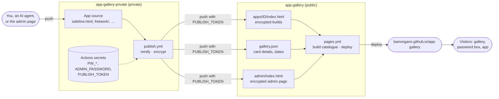

The rule that holds it all together: **readable source never goes into the
public repo.** Anything pushed there stays readable in its history, even
after it's deleted or encrypted.

What the gallery holds today (6 apps; 4 behind a password, 2 public):

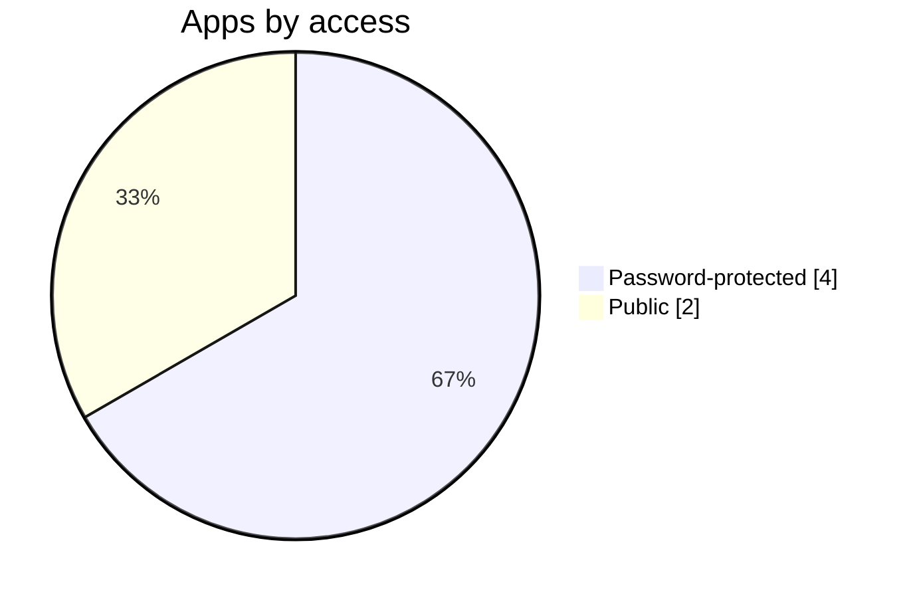

| Piece | Where | What it does |
|---|---|---|
| `index.html` | public repo | The gallery page: cards, filters, search, Refresh, Install/Download |
| `scripts/build-catalog.mjs` | public repo | Turns `apps/` and `gallery.json` into `apps.js` and `apps.json` on each deploy |
| `.github/workflows/pages.yml` | public repo | Builds the catalogue and deploys to GitHub Pages on every push to `main` |
| `protect.sh` | public repo | Encrypts one app with StatiCrypt (the publish workflow calls it) |
| `scripts/publish.mjs` | private repo | Minifies every changed app, encrypts protected ones, builds the admin page |
| `scripts/admin.html` | private repo | Template for the admin page |
| `.github/workflows/publish.yml` | private repo | Runs `publish.mjs` on every push to `main`, or by hand |
| `.published-from` | public repo | The private commit last published; the next publish takes every change since it |
| `archive/` | private repo | Apps hidden from the admin page; the publish skips it |
| `SPA-GUIDE.md` | public repo | The rules every app follows |

[↑ Contents](#contents)

---

## 2. Setup from scratch

Do this once. Steps 2.3 and 2.4 also cover renewing an expired token.

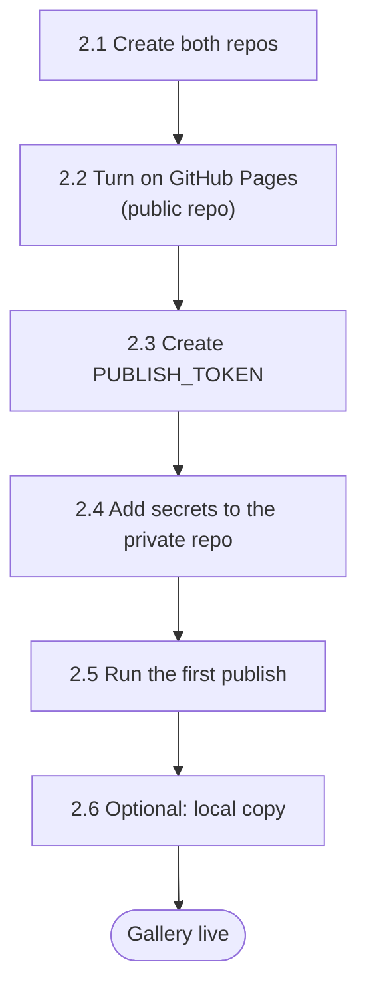

### 2.1 Create both repos

1. **Public:** `bamorgans/app-gallery`, holding `index.html`, `protect.sh`,
   `.staticrypt.json`, `scripts/`, `icons/`, `manifest.webmanifest` and
   `.github/workflows/pages.yml`.
2. **Private:** `bamorgans/app-gallery-private`, holding the apps,
   `scripts/publish.mjs`, `scripts/admin.html`, `package.json` and
   `.github/workflows/publish.yml`.

### 2.2 Turn on GitHub Pages

In the **public** repo: **Settings → Pages → Build and deployment → Source:
GitHub Actions**. From then on every push to `main` runs `pages.yml` and the
site updates.

### 2.3 Create the publish token

The private repo's workflow needs permission to push into the public repo.
That's a fine-grained personal access token:

1. On GitHub, click your avatar → **Settings → Developer settings → Personal
   access tokens → Fine-grained tokens → Generate new token**.
2. **Token name:** `app-gallery publish`.
3. **Expiration:** pick a date (90 days or a year). When it runs out the
   publish fails when it checks out the gallery, with an authentication
   error; repeat this section and 2.4 to renew it.
4. **Resource owner:** your account.
5. **Repository access:** **Only select repositories** →
   `bamorgans/app-gallery`. Only the public repo.
6. **Permissions → Repository permissions:** add **Contents** and set it to
   **Read and write**. (Metadata: Read-only is added by itself.) Nothing else.
7. **Generate token** and copy it now. GitHub shows it only once.

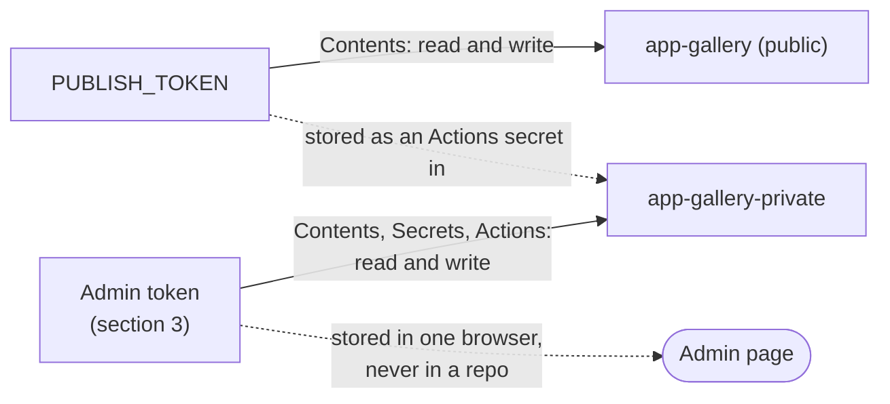

### 2.4 Add the secrets

In the **private** repo: **Settings → Secrets and variables → Actions → New
repository secret**, once for each:

| Secret | Value |
|---|---|
| `PUBLISH_TOKEN` | The token from 2.3 |
| `ADMIN_PASSWORD` | The admin page's master password. Long: 5+ random words |
| `PW_<ID>` | One per protected app. `<ID>` is the app's file name in capitals, dashes as underscores: `daily-fit.html` → `PW_DAILY_FIT` |

A public app must **not** have a `PW_` secret. If it has one, the publish
refuses to publish it, in case it was tagged public by mistake.

### 2.5 Run the first publish

Private repo → **Actions → Publish to the gallery → Run workflow**. A run by
hand rebuilds and re-encrypts every app. Its push to the public repo starts
the **Deploy gallery** run there; when both are green, open the gallery.

### 2.6 Optional: a local copy

```sh
git clone https://github.com/bamorgans/app-gallery.git
cd app-gallery
git clone https://github.com/bamorgans/app-gallery-private.git private   # git-ignored here
./serve.sh            # http://localhost:8000
```

`private/` inside the public checkout is git-ignored, which is what lets
`protect.sh` find plain copies there without risk of committing them.

[↑ Contents](#contents)

---

## 3. Admin: first-time use

The admin page is at the bottom of the gallery (**Admin**), or directly at
<https://bamorgans.github.io/app-gallery/admin/>. It's encrypted with
`ADMIN_PASSWORD`.

**Opening apps needs only the admin password.** Changing passwords and
removing apps also need a second token, pasted once on each device.

### 3.1 Open it

1. Open the admin page and enter `ADMIN_PASSWORD`. Tick **Remember me** on a
   device you trust (30 days).
2. Each app has an **Open** link that unlocks it without its own password.

### 3.2 Create the admin token

1. Avatar → **Settings → Developer settings → Personal access tokens →
   Fine-grained tokens → Generate new token**. (The admin page links there.)
2. **Name:** `app-gallery admin (<device>)`, e.g. `(iPhone)`, so you can
   revoke one device without touching the others.
3. **Expiration:** set one.
4. **Repository access:** **Only select repositories** →
   `bamorgans/app-gallery-private`.
5. **Permissions:** **Contents**, **Secrets** and **Actions**, each **Read
   and write**.
6. Generate and copy it.

### 3.3 Connect

Paste the token into **GitHub access → Token** and tap **Connect**. The page
checks it against GitHub and shows **Connected**. **Forget the token** removes
it from that browser.

The token is kept in that browser's storage only. It is deliberately not
built into the admin page: that page is public, protected only by
`ADMIN_PASSWORD`, and anyone who cracked it would get write access to every
app's source and password. Other pages on `bamorgans.github.io` share the
browser's storage, which is why the token should reach only the private repo
and expire.

### 3.4 What the admin page can do

| Button | Does | Takes effect |
|---|---|---|
| **Open** | Opens the app without its password, remembered 30 days | At once |
| **Password** | Sets the app's `PW_` secret and re-runs the publish | 1–2 min |
| **Delete → Hide from the gallery** | Moves the app's files to `archive/`, keeps its password | 1–2 min |
| **Delete → Delete permanently** | Removes the files and the `PW_` secret (type the app's id to confirm) | 1–2 min |
| **Hidden apps → Restore** | Moves the app back out of `archive/` | 1–2 min |
| **Change admin password** | Sets `ADMIN_PASSWORD` (12+ characters) and re-publishes | 1–2 min |

What happens behind **Password**:

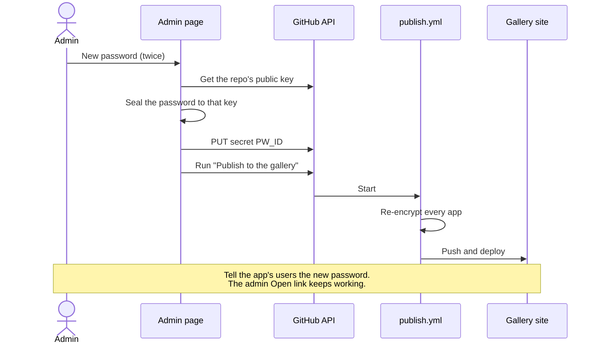

The password never leaves the browser unsealed. Only GitHub's Actions runner
can open it.

[↑ Contents](#contents)

---

## 4. Everyday use

### 4.1 Using the gallery

| Control | What it does |
|---|---|
| **Search box** | Filters cards by name, description and tags |
| **All / New / Updates / Public** | All apps; new or updated in the last 2 weeks; updated only; no password |
| **Category menu** | One tag, e.g. *football* |
| **Refresh** | Fetches the latest app list. It also checks on open and when the home-screen copy comes back to the front |
| **New badge** | Added, or given a new `APP_VERSION`, in the last 14 days (for an app without a version, any change to its source) |
| 🔒 | Needs a password |
| **Download** (computer, Android) | Saves the app as one HTML file that runs offline |
| **Install** (iPhone, iPad) | Shows how to add the app to the home screen from Safari |

### 4.2 Add an app

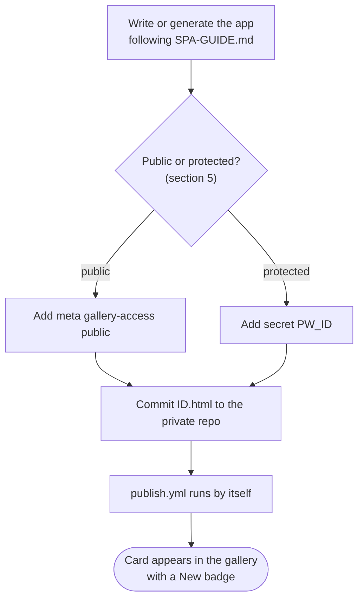

- **With an AI agent:** open <https://claude.ai/code>, choose
  `app-gallery-private`, and describe the app. The repo's `AGENTS.md` gives
  the agent the rules. An agent can't create secrets, so add `PW_<ID>`
  yourself.
- **By hand:** on github.com open the private repo → **Add file → Upload
  files** → drop in `<id>.html` → **Commit changes**.
- If you add the secret after the app, run the workflow by hand
  (**Actions → Publish to the gallery → Run workflow**).

### 4.3 Update an app

Edit it, **bump `APP_VERSION`** (`V00.01.002` → `V00.01.003`), and commit.
The new version gives the card a New badge for two weeks. Fretwork also has
a service worker: bump `VERSION` in `fretwork/sw.js` too, or installed copies
keep the old version.

### 4.4 Hide, restore or delete an app

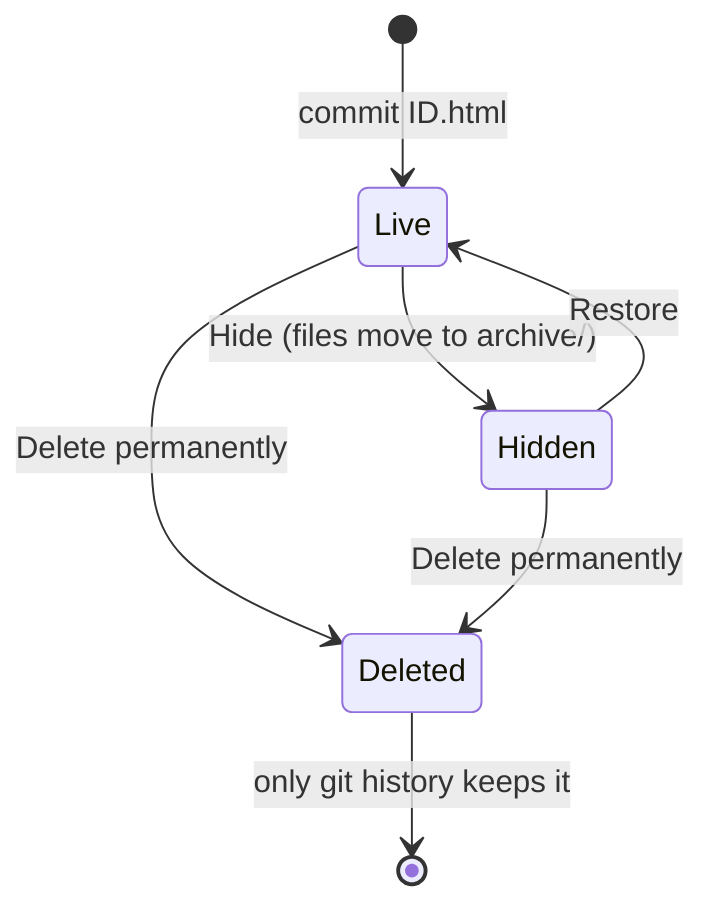

All three are on the admin page. By hand: delete or move `<id>.html` (or the
`<id>/` folder) in the private repo and commit.

### 4.5 How long a change takes

Typical timings from real runs:

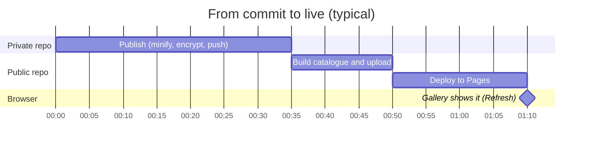

About **1–2 minutes**. Watch progress in each repo's **Actions** tab.

[↑ Contents](#contents)

---

## 5. Encryption: when and how

### 5.1 When to protect an app

Apps are **protected unless they say otherwise**. That's deliberate:
forgetting the tag leaves an app behind a password rather than exposed.

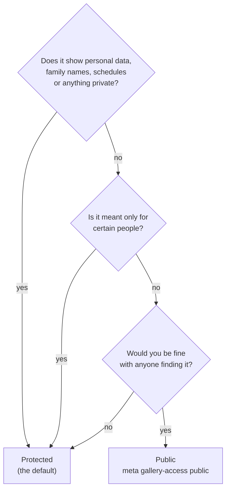

To make an app public, add this to its `<head>`:

```html
<meta name="gallery-access" content="public">
```

and make sure it has no `PW_` secret.

**Never** put API keys, tokens or passwords in an app, protected or not. Users
type keys into the app's Settings, where they stay in their own browser.

### 5.2 What encryption covers, and what it doesn't

| Protected by the password | Readable by anyone |
|---|---|
| The app's HTML, CSS, JS and built-in data | The app's **name, description, colour and tags** (`gallery.json`, the card) |
| Everything inside the single HTML file | Files beside `index.html` in a folder app: `sw.js`, manifest, icons |
| | That the app exists, and its URL |

So keep the card's description harmless, and keep anything private inside
the HTML file, not in extra files.

### 5.3 How it works

GitHub Pages can't restrict who sees a page, so a protected app is encrypted
instead, using [StatiCrypt](https://github.com/robinmoisson/staticrypt)
(AES-256, key derived from the password and the salt in `.staticrypt.json`).

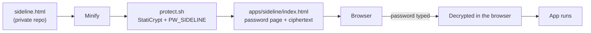

- Decryption happens in the visitor's browser. The password is never sent
  anywhere.
- **Remember me** keeps the unlock for 30 days, per app.
- A downloaded copy stays encrypted, asks for the password once, then works
  offline.
- The encrypted file is public, so it can be attacked offline. **A long
  password is the protection.** Use 4–5 random words, not a short word.
- `.staticrypt.json` holds the salt. It isn't secret, and it must stay
  committed: a new salt signs everyone out.

### 5.4 Encrypting by hand (testing only)

The publish workflow encrypts for you. To check the result locally:

```sh
cp ~/Desktop/some-app.html private/some-app.html
./protect.sh some-app --short     # asks for the password
./serve.sh                        # then open http://localhost:8000/apps/some-app/
```

Don't commit the result: the next publish overwrites `apps/`, and the source
belongs in the private repo.

### 5.5 Changing a password

Admin page → **Password** beside the app. By hand: update the `PW_<ID>`
secret, then **Actions → Publish to the gallery → Run workflow**. Either way,
tell everyone who uses the app. Their saved "Remember me" stops working and
they're asked for the new password.

[↑ Contents](#contents)

---

## 6. Sharing apps

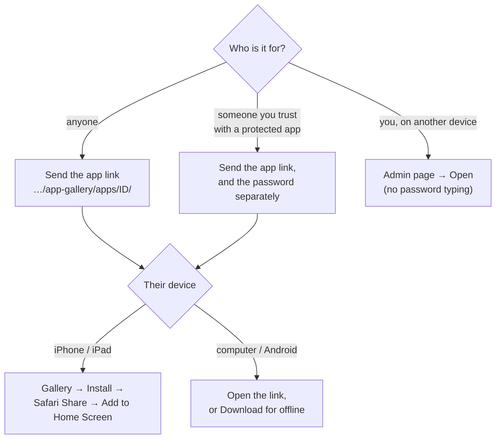

### 6.1 Links

| App | Link to send |
|---|---|
| The whole gallery | `https://bamorgans.github.io/app-gallery/` |
| One app | `https://bamorgans.github.io/app-gallery/apps/<id>/` |

- **Public app:** the link is all they need.
- **Protected app:** send the link, and the password **by a different
  route** (say, the link by email and the password by text).
- **Admin Open links** carry the unlock key in the link itself. Anyone who
  has one gets in without the password, so treat it like the password. Keep
  them for your own devices. Changing the app's password invalidates the old
  links.
- **Taking access away** from one person means changing the password and
  telling everyone else. There's one password per app.

### 6.2 Installing on a phone

- **iPhone / iPad:** in the gallery, tap **Install** on the card and follow
  the steps: open the app in Safari → **Share** → **Add to Home Screen**. It
  then opens full-screen like a native app. The home-screen copy keeps its
  own storage, so a protected app asks for its password once more there.
- **Android / computer:** **Download** saves one HTML file that runs offline
  from disk. Or open the link and use the browser's own **Install** or
  **Add to Home screen**.

### 6.3 Data doesn't travel with a link

Each copy of an app (the website, the home-screen copy, a downloaded file)
keeps its own saved data. To move data between them, use the app's
**Export** and **Import** in Settings.

[↑ Contents](#contents)

---

## 7. Building an app

The full rules are in [`SPA-GUIDE.md`](../SPA-GUIDE.md). From a phone, give
any AI chat the raw link:
<https://raw.githubusercontent.com/bamorgans/app-gallery/main/SPA-GUIDE.md>.
The admin page has a ready-made prompt to copy.

The essentials:

- **One HTML file**, everything inline, and it runs from `file://` with no
  network.
- A **head** with `<title>Name — tagline</title>`, `description`,
  `theme-color` and `gallery-tags`. The gallery card is built from them.
- An **`APP_ID`** (the file name, `water-tracker`) prefixing every storage
  key, since all apps share one browser storage.
- An **`APP_VERSION`** `Vmm.nn.ddd`, bumped on every change.
- **Export / Import** of the user's data.
- Works with **touch, mouse, keyboard and TV remote**, in light and dark.

[↑ Contents](#contents)

---

## 8. Troubleshooting

| Symptom | Cause | Fix |
|---|---|---|
| Publish fails at "Check the token is set" | `PUBLISH_TOKEN` missing | Make one (2.3), add the secret (2.4) |
| Publish fails checking out `bamorgans/app-gallery` (authentication error) | `PUBLISH_TOKEN` expired or revoked | Make a new one (2.3), replace the secret |
| Publish run red: "needs a secret named PW_…" | Protected app without a password | Add the secret (2.4), run the workflow |
| "tagged gallery-access public but also has a PW_ secret" | Both public tag and password | Remove one |
| Deploy fails: "No artifacts named github-pages were found" | GitHub hadn't listed the upload yet | Re-run the failed job |
| New app not in the gallery | Deploy still running, or an old list | Wait 1–2 min, tap **Refresh** |
| Admin: "GitHub rejected the token" | Admin token expired or revoked | **Forget the token**, make a new one (3.2) |
| Admin: "The token can't do this" | Missing a permission | Token needs Contents, Secrets, Actions: read and write |
| Admin: "The new password is saved, but the publish didn't start" | Token lacks **Actions** | Run the workflow by hand; fix the token |
| An app isn't on the admin page | Its source isn't in the private repo (RideScan lives only in the public repo) | Move its source into the private repo to manage it there |
| iPhone keyboard won't open on the password box | Old encrypted build | Re-run the publish workflow |
| Asked for the password again | "Remember me" expired, or the password changed | Enter the current password |

[↑ Contents](#contents)

---

## 9. Cheatsheet

**Links**

| | |
|---|---|
| Gallery | <https://bamorgans.github.io/app-gallery/> |
| Admin page | <https://bamorgans.github.io/app-gallery/admin/> |
| One app | `https://bamorgans.github.io/app-gallery/apps/<id>/` |
| Private repo | <https://github.com/bamorgans/app-gallery-private> |
| New token | <https://github.com/settings/personal-access-tokens/new> |
| Build guide | <https://raw.githubusercontent.com/bamorgans/app-gallery/main/SPA-GUIDE.md> |

**Tokens and secrets**

| Name | Where it lives | Scope |
|---|---|---|
| `PUBLISH_TOKEN` | Private repo secret | `app-gallery` only · Contents RW |
| Admin token | One browser | `app-gallery-private` only · Contents, Secrets, Actions RW |
| `ADMIN_PASSWORD` | Private repo secret | Unlocks the admin page |
| `PW_<ID>` | Private repo secret | One per protected app (`daily-fit` → `PW_DAILY_FIT`) |

**Tasks**

| To… | Do |
|---|---|
| Add an app | Commit `<id>.html` to the private repo; add `PW_<ID>` unless public |
| Make an app public | `<meta name="gallery-access" content="public">`, no `PW_` secret |
| Update an app | Edit, bump `APP_VERSION`, commit |
| Change a password | Admin → **Password** |
| Hide / restore | Admin → **Delete → Hide** / **Hidden apps → Restore** |
| Delete for good | Admin → **Delete → Delete permanently**, type the id |
| Re-encrypt everything | Private repo → Actions → Publish to the gallery → Run workflow |
| Share a protected app | Link one way, password another |
| Install on iPhone | Gallery → **Install** → Safari → Share → Add to Home Screen |
| Use offline | Gallery → **Download** |
| See the latest list | Gallery → **Refresh** |
| Run locally | `./serve.sh` → <http://localhost:8000> |
| Test encryption | `./protect.sh <id> --short` (don't commit the output) |

**Rules**

- Source only in the private repo. Never in `apps/` here, not even briefly.
- No keys, tokens or passwords in any app or commit.
- Long passwords: the encrypted files are public.
- Card details are public, even for protected apps.

[↑ Back to the top](#app-gallery-cookbook)
